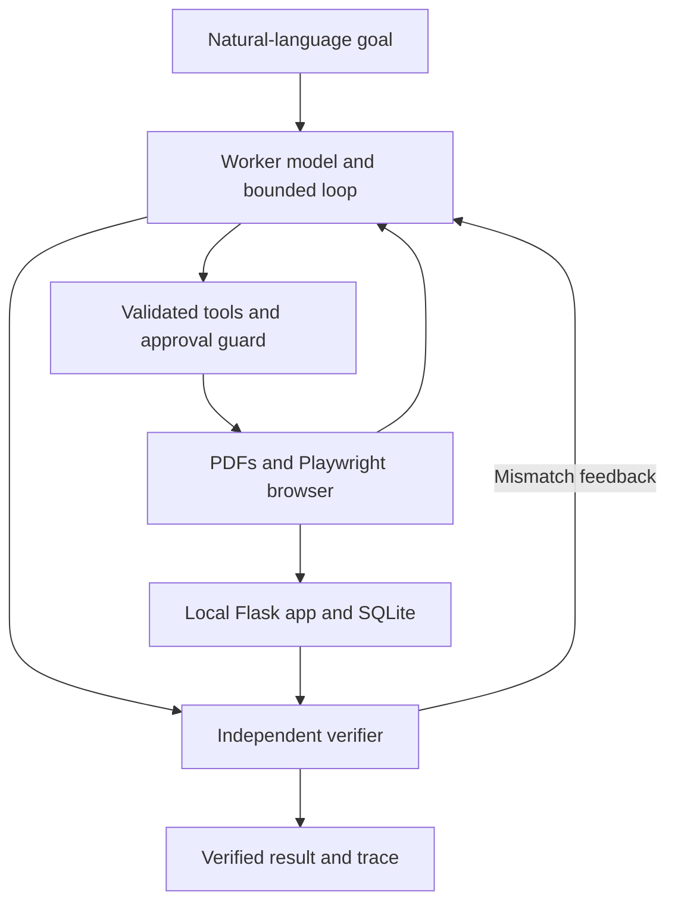

# CentrAlign Agent — Vendor Bills worker

<!-- checkpoint-status:start -->
## Current validation status (21 October 2026)

Latest per-scenario results: **8/8 PASS**. All recorded evaluation attempts: **16/24 PASS (66.7%)**.

These development results span different code revisions and models. The latest result for each scenario is reported separately from the complete attempt history. Earlier evaluation figures elsewhere in this README are historical snapshots.

See [evaluation results](evals/results.md) and [individual checks and attempt data](evals/results.json).

### Verification and execution

- Bill submission includes source-backed checks of vendor, invoice number, amount and due date before approval.
- The independent verifier reloads saved records and compares their values with original documents and relevant human answers before model-based goal verification.
- Denied bill submissions are checked using the approval audit and fresh saved records.
- Repeated navigation triggers a temporary restriction on redundant navigation choices.

### Additional evidence

- [Manual tampering trace](runs/sample_run/tamper_check/trace.json): the saved amount was changed to 9999.00; verification rejected it against the invoice amount of 1920.00. The run was subsequently cancelled manually.
- [Fresh-clone browser screenshot](runs/sample_run/fresh_clone/browser_check.png): installation in a separate virtual environment, database seeding, imports, Flask startup, and Chromium navigation/form filling passed on Windows with Python 3.13. This was a setup smoke check.

### Current limitations

- Source-value validation supports the supplied synthetic invoice layout.
- The form remains editable during the approval pause. Verification checks the persisted values afterward.
- The app has no bill-edit workflow or automatic rollback; detecting an incorrect saved record does not repair it.
- Groq quota limits can interrupt runs. Evaluation history retains these failures.
- Models used during development: `openai/gpt-oss-120b` and `openai/gpt-oss-20b`, through Groq's hosted API. Model inference requires internet access.

**Demo video:** recording and upload pending.
<!-- checkpoint-status:end -->

A Python task worker that takes a natural-language request, chooses tools, controls a local browser, and verifies the saved outcome.

The sandbox app and browser run on the laptop. Language-model requests use Groq over the internet.

**Demo video:** ADD_VIDEO_LINK

## What it does

Example task:

> Find the latest invoice from Globex Logistics, enter it into the Vendor Bills system, and tell me when it is done.

The worker can:

- Read synthetic invoice PDFs and enter bills through the browser.
- Convert date formats and calculate dates from explicit payment terms.
- Ask the human for missing information.
- Request approval before submitting or saving.
- Recover from app errors, including an injected one-time HTTP 503.
- Check persisted records independently of its own completion claim.
- Save JSON traces and screenshots.

The same worker also updated Acme Supplies' payment terms to `net 45` through the browser, with approval and independent verification. This different task used the existing loop and tools without a task-specific code change.

## Setup and run

Developed with Python 3.13 on Windows and VS Code.

Run these PowerShell commands individually:

```powershell
git clone https://github.com/Manasjyoti-99/centralign-agent.git
cd centralign-agent
python -m venv .venv
.\.venv\Scripts\python.exe -m pip install -r requirements.txt
.\.venv\Scripts\python.exe -m playwright install chromium
Copy-Item .env.example .env
```

Edit `.env` and supply your own Groq API key. The latest approval-denial and vendor-update evaluations used this fallback configuration:

```dotenv
LLM_API_KEY=replace_with_your_groq_api_key
LLM_BASE_URL=https://api.groq.com/openai/v1
LLM_MODEL=openai/gpt-oss-20b
VERIFIER_MODEL=openai/gpt-oss-20b
APP_URL=http://localhost:5000
HEADLESS=0
```

Existing terminal environment variables take precedence over `.env`.

The client uses the official `groq` Python SDK and its default endpoint. `LLM_BASE_URL` is retained in configuration but is not passed to that SDK.

Generate the sample invoices and initialize the database:

```powershell
.\.venv\Scripts\python.exe -m data.generate_invoices
.\.venv\Scripts\python.exe -m app.seed
```

In terminal 1, start the app and leave it running:

```powershell
.\.venv\Scripts\python.exe -m app.server
```

In terminal 2, from the project folder:

```powershell
.\.venv\Scripts\python.exe -m agent.main "Find the latest invoice from Globex Logistics, enter it into the Vendor Bills system, and tell me when it is done."
```

A different task uses the same entry point:

```powershell
.\.venv\Scripts\python.exe -m agent.main "Update the payment terms for Acme Supplies to 45 days."
```

Chromium opens automatically. Inspect the displayed form values before entering `y` at an approval prompt. Enter or `n` denies approval and ends the run. Answer missing-information questions in the terminal.

`HEADLESS=1` hides Chromium; terminal approvals still apply.

The seeded database contains GLX-2201. A successful Globex run adds GLX-2305, amount 1920.00, due 2026-10-17.

To reset this sandbox, open the following URL in your ordinary browser:

```text
http://localhost:5000/admin/reset?flaky=0
```

Use `flaky=1` to make the first valid bill submission return HTTP 503. Resetting removes previous sandbox edits. The agent cannot access admin routes.

## Architecture



| Component | Responsibility |
|---|---|
| `agent/loop.py` | Up to 25 worker turns, tool execution, observations, and verification feedback. |
| `agent/llm.py` | Groq calls, function-call messages, bounded retries, and response handling. |
| `agent/prompts.py` | General instructions for tool use, source grounding, recovery, and verification. |
| `agent/browser.py` | Chromium control, text snapshots, dropdown selection, origin restrictions, and fresh-page reads. |
| `agent/tools.py` | Tool schemas, argument validation, restricted file access, PDF extraction, date arithmetic, clarification, and finish requests. |
| `agent/guard.py` | Human approval before writes and blocking an identical action after three failures. |
| `agent/state.py` | Scratchpad, document evidence, human answers, approvals, and run status. |
| `agent/verifier.py` | Independent saved-record checks, source grounding, model judgment, and a deterministic denied-bill check. |
| `agent/trace.py` | JSON event logs, screenshots, final status, and configured-key redaction. |
| `app/` | Flask sandbox, SQLite database, validation, seeded data, and failure injection. |
| `evals/` | Scenario definitions, SQLite checks, trace audits, and attempt history. |

## Design decisions

### Handwritten agent loop

No agent framework is used. The model chooses actions through a fixed tool interface; Python validates and executes them. This makes the control flow and safety boundaries easier to inspect and explain.

The worker receives general instructions about discovering information, grounding values, recovering from errors, and verifying outcomes. It does not receive a fixed sequence of invoice-processing steps.

### Text observations

The model receives page text, field values, selectors, buttons, and links. Screenshots are saved as evidence for humans.

This reduces prompt size but limits the prototype to interfaces that expose useful text and form structure.

### Persistent evidence and bounded execution

PDF text, file lists, a short action log, human answers, and scratchpad survive between turns. Older tool exchanges are trimmed to reduce repeated reads and context loss.

Runs are limited to 25 worker turns. Network and rate-limit retries are bounded.

### Controls enforced outside the model

File access is restricted to `data/`. Browser navigation is restricted to the configured app origin, and admin routes are blocked.

The guard inspects click targets and asks for approval before write-like actions, including submit/save buttons. Denying approval stops further worker execution.

### Independent verification

A final text reply or `finish` call requests verification; it does not declare success.

For completion checks, the verifier reloads visited URLs in fresh tabs, rereads original PDFs, and makes a separate model call without the worker's final claim. It checks the goal against saved records and source evidence. Verification failure returns feedback to the worker.

An additional source prerequisite rejects bill completion when a required due date has no supported source or human answer.

For a denied new-bill submission, verification is deterministic: it checks the actual guard event sequence and opens the saved Bills table in a fresh tab to confirm the invoice is absent. This produces `not_completed`, never task completion. Other completion and blocker checks continue through the model verifier.

## Evaluation and results

Keep the app running. Run one case at a time:

```powershell
.\.venv\Scripts\python.exe -m evals.run_evals --list
.\.venv\Scripts\python.exe -m evals.run_evals globex_latest
```

Run the full suite with:

```powershell
.\.venv\Scripts\python.exe -m evals.run_evals --all
```

Each case resets the sandbox. Do not run another agent concurrently.

Approvals and clarification answers are scripted only by the evaluation harness. They still pass through the normal tools and guard.

The grader checks SQLite before and after each run: exact saved values, existing records, new-record count, and permitted vendor edits. It also checks approval events, clarification timing, retry evidence, fresh-page evidence, and final status.

### Development results

Latest results: **8/8 tested scenarios passed**, with **8/8 coverage**.

Across all recorded development attempts: **8/12 passed (66.7%)**.

| Scenario | Latest result | Worker model |
|---|---|---|
| Globex latest invoice | PASS | `openai/gpt-oss-120b` |
| Acme date conversion | PASS | `openai/gpt-oss-120b` |
| Temporary HTTP 503 recovery | PASS | `openai/gpt-oss-120b` |
| Duplicate left unchanged | PASS | `openai/gpt-oss-120b` |
| Missing due date → human clarification | PASS after an earlier failure | `openai/gpt-oss-120b` |
| Explicit net-45 calculation | PASS | `openai/gpt-oss-120b` |
| Approval denied → no bill created | PASS after earlier failures | `openai/gpt-oss-20b` |
| Vendor payment-term update | PASS | `openai/gpt-oss-20b` |

These outcomes span code revisions and models. They are not a single full-suite run on the final revision or a fixed-version reliability estimate.

See [evals/results.md](evals/results.md) and `evals/results.json` for attempt history, timings, models, and failed checks. Earlier failures are retained, including an unsupported date initially accepted by the model verifier and provider quota failures.

### Execution evidence

`runs/sample_run/trace.json` and its screenshots preserve an earlier successful Globex execution using `openai/gpt-oss-120b`.

New executions save their traces and screenshots locally under `runs/<UTC timestamp>/`.

To run the verifier check against the seeded bill:

```powershell
.\.venv\Scripts\python.exe -m agent.verifier
```

The latest check accepted saved GLX-2201 amount 1200.00 and rejected an explicit target amount of 9999.00.

This checks an incorrect expected amount against a saved record. A manual form change during an approval pause has not been tested.

## Assumptions and known limitations

- This is a narrow prototype using synthetic data and a controlled local app.
- Groq requires internet access and a user-provided API key. Free-tier quotas can prevent completion.
- Provider-requested waits above 60 seconds stop the request rather than hanging indefinitely.
- Development used `openai/gpt-oss-120b`; `openai/gpt-oss-20b` was used as a quota fallback. Results are labeled by model.
- Native text PDFs are supported. Scanned documents need OCR, which is not implemented.
- Documents and evidence have size limits.
- The worker loop is reusable, but selectors, snapshots, the bill date prerequisite, and the denied-bill rule assume this sandbox's structure.
- The model verifier is fallible. Source checks and independent database evaluations reduce errors without proving universal correctness.
- Verification happens after writes and does not roll them back.
- The app has no production authentication, concurrent-user isolation, or accounting/currency precision model.
- Runs have a 25-step limit and no restart/resume support.
- Correct selection of the latest document is not guaranteed on every attempt.

## Models, APIs, and libraries

- Models: `openai/gpt-oss-120b` and `openai/gpt-oss-20b`, hosted by Groq.
- API client: official `groq` Python SDK with OpenAI-style function-call schemas.
- Browser: Playwright Chromium, synchronous API.
- App: Flask and Python's SQLite module.
- Documents: ReportLab and pypdf.
- Configuration: python-dotenv.
- Full dependencies: `requirements.txt`.
- No LangChain or other agent framework is used.

## What I would build next

1. Repeated full-suite runs on a frozen revision and model.
2. Stronger structured comparisons between original sources and saved records.
3. Approval bound to the exact values submitted.
4. Resumable execution and better recovery from provider limits.
5. OCR and adapters for additional apps, after improving reliability.